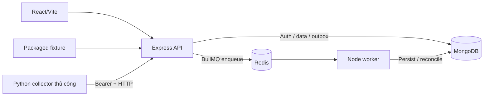
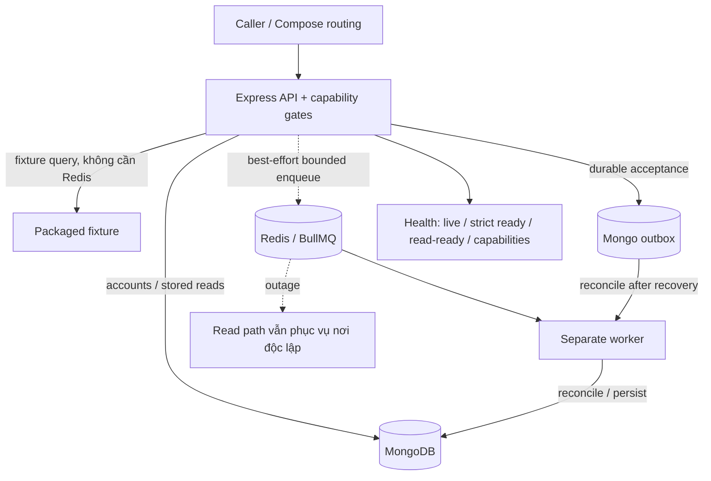
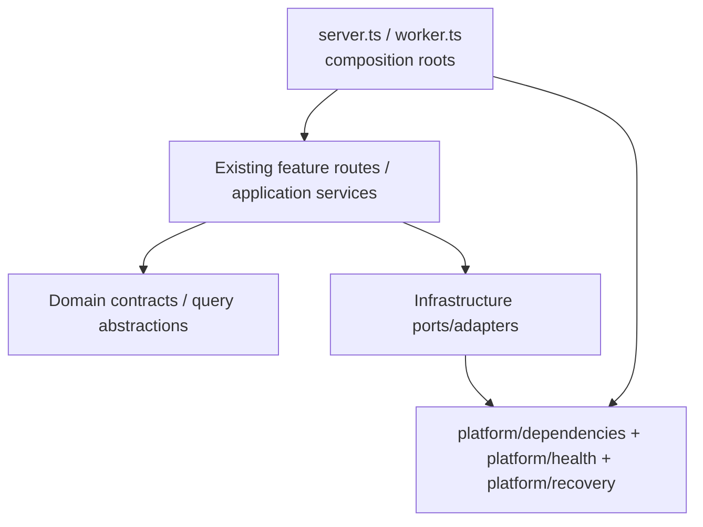

# MarketPulse VN — A4 Architecture Requirements
## Dependency Health, Fault Isolation & Recovery

| Thuộc tính | Giá trị |
|---|---|
| Document ID | `MP-ARCH-A4-REQ-001` |
| Phiên bản | `1.1` — 21/10/2026 (bổ sung folder architecture và module boundaries) |
| Trạng thái | **Requirements / proposed design; chưa triển khai, chưa nghiệm thu A4** |
| Repository | https://github.com/Son2110/Market-Pulse |
| Baseline kiểm tra | `main` @ `eb3a6b28389f1cb3ec5d6161d286136e0f67ffee` (PR #38) |
| Workstream | A4 — Dependency health/recovery (liên quan FR-18 / reliability foundation) |
| Branch theo roadmap | `ci/dependency-health-recovery` |
| Điều kiện tiên quyết | A1–A3 đã merge; P2.1 research là nhánh công việc độc lập được đặt trước A4 trong roadmap |
| Release gate | **Phải được nghiệm thu trước P2.2 (news ingestion) hoặc bất kỳ collector tự động nào** |

> **Cách đọc tài liệu:** `MUST` là yêu cầu bắt buộc để chấp nhận A4; `SHOULD` là khuyến nghị có thể hoãn với lý do và bằng chứng; `OUT OF SCOPE` không được tự triển khai trong A4. Các API/example JSON bên dưới là **giao diện đề xuất**, không phải endpoint đang có. Không được đánh dấu `DONE` chỉ vì đã viết tài liệu hoặc CI của commit cũ thành công.

---

## 1. Mục tiêu & câu hỏi cần giải quyết

**Mục tiêu:** API tiếp tục phục vụ các chức năng đọc không phụ thuộc Redis khi Redis/BullMQ mất kết nối; những capability thật sự cần dependency bị lỗi phải thất bại an toàn; ingestion vẫn giữ **durable-accept-before-HTTP-202**, outbox/idempotency/replay, và worker hồi phục có kiểm soát sau khi dịch vụ trở lại. Health và routing phải phản ánh hành vi thực tế.

**Không được hiểu A4 là:** xóa Redis khỏi readiness, biến mọi route thành `200 OK`, giả lập thành công khi MongoDB mất, thay toàn bộ queue, hoặc viết framework health/retry tổng quát.

### 1.1 Baseline đang chạy — AS-IS



1. `server.ts`: `Promise.all` kết nối cả Mongo và Redis; biến `connectedBefore` chỉ `true` khi **cả hai** cùng kết nối; Redis `error/end` sau kết nối sẽ trigger `shutdown(..., 1)`.
2. `health.ts`: `/health/live` là process liveness; `/health/ready` `200` khi cả Mongo/Redis ping đạt và application initialized.
3. `compose.yaml`: API healthcheck gọi **full** `/health/ready`; container API phụ thuộc Redis `service_healthy`, nên cold-start không bảo đảm read-service tồn tại nếu Redis bị lỗi.
4. `ingestion-api.ts` ghi delivery durable vào Mongo trước `202`, enqueue bounded 1,5 giây; enqueue lỗi thì để receipt ở Mongo cho reconciliation.
5. `worker.ts` và `ingestion-worker.ts`: worker riêng, readiness nội bộ port `3002`; dùng BullMQ, quét outbox nonterminal khoảng 5 giây, `MAX_ATTEMPTS=3`, có cơ chế retry/terminal.
6. Fixture search/history đọc packaged fixture; observed/gold stored reads dùng Mongo và được bảo vệ bằng flags `OBSERVED_READS_ENABLED=false`, `GOLD_READS_ENABLED=false` mặc định.
7. Chưa có market cache, time-series projection, news/AI pipeline hoặc automated collector. **A4 không được giả định chúng đã tồn tại.**

**Vấn đề:** Redis là dependency của ingestion, **không** phải dependency trực tiếp của fixture search, stored observed/gold reads hay auth/watchlist; tuy nhiên Redis outage hiện có thể làm toàn bộ API ngừng phục vụ hoặc bị healthcheck đánh `unhealthy`.

### 1.2 TO-BE cho A4



**Kiến trúc giữ nguyên:** modular monolith, một Node codebase / hai processes API-worker; collector Python riêng; MongoDB là durable authority và Redis chỉ vận chuyển job.

---

## 2. Scope & invariants không được phá vỡ

### In scope (MUST)

- Redis loss/reconnect lifecycle trong **API** mà không dừng các route độc lập Redis.
- Read-serving health/routing, đồng thời giữ **strict full readiness** để báo dependency tổng thể.
- Capability-aware dependency checks và phản hồi suy giảm đúng cho các route đã có.
- Reconnection/recovery hữu hạn, không tạo connection storms hoặc timer rò rỉ.
- Durable ingestion outbox và fail-safe response khi MongoDB không available.
- Worker Redis/Mongo loss-restoration; retry, reconciliation, idempotency và trạng thái delivery giữ đúng.
- Compose/CI/integration tests cho outage → restoration và các trường hợp startup.
- **Folder architecture & module boundaries cho health/recovery:** tổ chức code mới theo trách nhiệm rõ ràng, không thực hiện big-bang migration các module nghiệp vụ.
- Structured logs an toàn, tài liệu vận hành/rollback, regression tests trên baseline hiện tại.

### Không thay đổi (MUST PRESERVE)

- Wire payload schemas/versions, JSON canonicalization, SHA-256 digest, `deliveryId`, `jobId`, BullMQ queue/job names.
- Three families: `fixture-market`, `observed-candle`, `synthetic-gold`; phân loại sau validate, không thêm discriminator ra wire.
- Legacy receipts/outbox (thiếu `family`, malformed/terminal `invalid_contract`) được A3 hỗ trợ.
- `202` = **durably accepted**, không phải worker đã hoàn tất; `success` chỉ sau khi đã ghi xong theo contract.
- `409` cho cùng delivery ID nhưng khác digest; same ID + same digest không tạo bản ghi canonical trùng.
- Immutable revisions, latest projection ordering; không xóa/quét dữ liệu hiện tại để sửa lỗi.
- Price decimal string ở observed/gold, UTC microseconds, các nhãn provider/as-of/freshness; không bịa giá hay tự fill missing data.
- Public fixture mặc định, observed/gold read flags `false`, ingestion disabled khi thiếu `INGESTION_SECRET`.
- Auth ownership trên server; không vô hiệu hóa auth, lộ secret/token/raw payload, không mở ingestion API không xác thực.

### Out of scope

- News collector/AI/events, vàng thật, schedule collector tự động, public data-rights clearance.
- Microservices, Kafka, Kubernetes, distributed locking/framework, đổi database, new market cache, time-series projection, bulk migration.
- Di chuyển hàng loạt các file Auth, Market, Gold, Observed hoặc đổi toàn bộ route/API contract chỉ để “đẹp folder”.
- Redesign stock/gold UI hoặc tự chuyển fixture sang live/observed.
- Chứng nhận HA/multi-region hay zero-downtime production khi chưa có hạ tầng và load tests.

---

## 3. Architecture Requirements có thể nghiệm thu

### A4-ARCH-01 — Tách vòng đời HTTP API khỏi Redis queue (MUST)

**Given** MongoDB/market provider cần thiết đã khởi tạo thành công, **when** Redis disconnect, **then** API HTTP process **không tự exit chỉ vì Redis**; các route đọc không dùng Redis vẫn có thể được gọi.

- Redis `error`, `end`, `reconnecting` không được luôn gọi `shutdown` global như code cũ.
- Phân biệt trạng thái Redis dùng cho queue producer với MongoDB và fixture; tránh dùng một boolean `connectedBefore` để quyết định mọi capability.
- Redis tại **cold start** không sẵn sàng: API có thể khởi động ở degraded-read mode nếu fixture đã khởi tạo và MongoDB startup đạt điều kiện. Worker không được giả thành ready.
- Không retry vô hạn không kiểm soát, không lặp timer/clients sau reconnect; chỉ **một** recovery loop cho mỗi client/role, có backoff/cancellation.
- Shutdown theo SIGTERM/SIGINT vẫn graceful; trong startup/outage/shutdown race không tạo unhandled rejections.

**Acceptance:** gọi fixture search/history thành công sau khi Redis tắt; API PID không đổi chỉ do Redis mất; khi Redis trở lại API phục hồi queue producer mà không yêu cầu xóa state.

### A4-ARCH-02 — Giữ full readiness và thêm read-serving health (MUST)

Yêu cầu tách ít nhất **4 khái niệm**, không gộp thành một cờ `healthy`:

| Signal | Vai trò | Quy tắc |
|---|---|---|
| `GET /health/live` | HTTP process còn sống | `200` nếu process đang sống; không thực hiện network probes tốn kém |
| `GET /health/ready` | **Full** readiness (strict) | `200` chỉ khi tất cả dependency được enable và required đã sẵn sàng; Redis out -> `503` nếu queue là required của full service |
| `GET /health/read-ready` | Routing probe cho **public fixture read** (đề xuất) | `200` nếu API phục vụ được fixture search/history; Redis out không tự tạo `503`; không khẳng định Mongo-dependent routes đều ready |
| `GET /health/capabilities` | Chẩn đoán trạng thái capability (đề xuất) | Trả sanitized trạng thái fixture read, account/watchlist, stored reads, ingestion accept, queue/worker; không lộ nội bộ |

**Lưu ý thiết kế:** Tên endpoint ngoài `/health/live` và `/health/ready` có thể đổi khi ADR quyết định; bắt buộc giữ **các ngữ nghĩa** trên và test route/routing tương ứng. Nếu giữ nguyên Compose API healthcheck dùng strict ready thì Redis out làm API `unhealthy` dù HTTP còn chạy. A4 **MUST** sửa healthcheck/routing để read traffic thực sự còn tới được API. Đừng chỉ thêm endpoint nhưng không sử dụng nó trong đường phục vụ.

**Ví dụ payload đề xuất cho capability health** (không tuyên bố đang implement):

```json
{
  "status": "degraded",
  "capabilities": {
    "fixtureRead": "ready",
    "account": "ready",
    "storedReads": "ready_if_enabled",
    "ingestionAcceptance": "ready",
    "queueDispatch": "unavailable"
  }
}
```

- Payload chỉ là nhãn tổng hợp, không liệt kê connection string, secrets, stack trace hay tên DB nhạy cảm.
- **Không gọi tên trạng thái `ingestionAcceptance: ready` khi thiếu ingestion secret**: khi disabled phải là `disabled`.
- Health probes có timeout và không tăng tải quá mức; không chặn event loop.
- Khi Mongo mất, `read-ready` chỉ được `200` nếu read route được nó bảo đảm thật sự chạy; account/stored reads phải báo không ready.

### A4-ARCH-03 — Quy tắc capability/route khi lỗi (MUST)

| Capability / Endpoint hiện hành | Dependency thực | Redis out + Mongo up | Mongo out | Ghi chú |
|---|---|---|---|---|
| `GET /api/assets/search?q=FPT` | Initialized fixture/catalog | **200**, đúng fixture + labels | Có thể **200** nếu đã initialized/không cần Mongo | Không lấy cache/queue làm phụ thuộc mới |
| `GET /api/assets/FPT/history` | Initialized fixture | **200** | Có thể **200** nếu fixture sẵn sàng | Không tự chuyển sang stored data |
| `GET /api/auth/me` | Mongo sessions/users | **200** nếu session hợp lệ | Fail safe **503** nếu backend không truy vấn được; 401 chỉ cho token không hợp lệ | Không trả fake authenticated user |
| `POST /api/auth/register/login` | Mongo | Hoạt động với controls hiện có | Fail safe, không khẳng định tạo/login thành công | Giữ rate/KDF guards, ownership |
| `/api/watchlists/**` | Mongo (+ fixture summary) | Hoạt động khi Mongo up | Fail safe `503` nếu DB không khả dụng | Không làm mất dữ liệu đã lưu |
| `GET /api/observed/assets/{symbol}/history` | Mongo + enabled flag | Hoạt động **chỉ khi flag bật và data có sẵn** | `503` khi đã enable nhưng Mongo lỗi | Không tự fallback fixture |
| `GET /api/gold/quotes/latest/history` | Mongo + enabled flag | Hoạt động **chỉ khi flag bật và data có sẵn** | `503` khi đã enable nhưng Mongo lỗi | Nếu flag off, giữ route behavior baseline |
| `POST /internal/ingestion/deliveries` | Ingestion secret, validated payload, Mongo outbox | Có thể `202` **sau durable Mongo accept**; enqueue deferred | **Không được `202`** | Bảo đảm acceptance semantics |
| `GET /internal/ingestion/deliveries/{id}` | Secret, Mongo | Đọc receipt đã lưu | Fail safe `503` | `success` không được đoán từ queue |
| Worker background ingestion | Mongo + Redis/BullMQ | Dừng xử lý mới/ready=false; hồi phục sau Redis restore | Không ghi tiếp hoặc mark success giả | Không lặp attempt ngoài budget |

**Điều kiện:** bảng là **target A4**. Mọi hành vi `200/202` cần integration evidence; nếu chưa kiểm thử thì không ghi vào README là “available during outage”. Nếu thiếu đủ điều kiện init ở cold start, fail readiness theo thực tế, không giả ready.

### A4-ARCH-04 — Redis producer reconnect có kiểm soát (MUST)

- Queue enqueue trong HTTP phải **bounded**; giữ quyết định không kéo dài request tùy tiện.
- Khi Redis down, việc enqueue lỗi/timeout không làm mất delivery Mongo đã accept, không làm crash process.
- Khi Redis trở lại: producer reconnect/thay client an toàn; tránh listener/timer duplicate và producer cũ nhận job sau khi close.
- Reconcile outbox active phải diễn ra qua worker một cách quyết định; **không cần** HTTP request mới hoặc manual replay để cứu delivery bị treo.
- Khi queue vẫn không sẵn sàng, ingestion receipt có thể ở `accepted`; không được báo `success`.
- Nếu implementation chọn lazy queue producer, phải có bằng chứng nó khởi động và recover đúng (bao gồm `INGESTION_SECRET` bật/tắt).

### A4-ARCH-05 — MongoDB failure phải fail closed (MUST)

- `POST /internal/ingestion/deliveries` chỉ trả `202` khi durable Mongo write đã hoàn thành (`w:1, j:true` giữ nguyên baseline, hoặc điều kiện mạnh hơn được review).
- Mongo timeout/disconnect/write failure -> `503` hoặc mã lỗi tương đương **không xác nhận acceptance**. Client có thể retry *same ID + same digest* sau phục hồi.
- Không tạm lưu accepted deliveries trong bộ nhớ API rồi trả `202` nếu chưa có durable guarantee.
- `GET /health/ready` (strict) phải fail khi Mongo required unavailable; các route phụ thuộc Mongo không được trả dữ liệu giả.
- Không thay đổi DB credentials, account sessions, snapshots hoặc historical revisions để “khôi phục nhanh”.

### A4-ARCH-06 — Worker pause, retry, replay và hồi phục (MUST)

- Worker readiness (`127.0.0.1:3002`, chưa publish port ra ngoài) phản ánh **Mongo + Redis + worker running + recent reconciliation**, không dựa vào việc process còn sống đơn thuần.
- Redis outage -> worker không report ready; không cố xử lý bằng cách đánh dấu delivery thành công khi chưa persistence.
- Worker sau restore (tự reconnect/restart có giám sát được kiểm thử) tiếp tục đọc outbox, enqueue/consume các active deliveries và hoàn thành **mà không cần xóa Redis/Mongo volumes**.
- Vẫn dùng `MAX_ATTEMPTS=3` và các terminal failure rules; không tự reset attempt budget do reconnect/restart.
- Không chuyển delivery terminal `failure` về active vô điều kiện; giữ A3 `invalid_contract` quarantine/legacy compatibility.
- Reconcile cần được chứng minh khi có job đang `queued`, `running`, `stalled` hoặc receipt `accepted` nhưng chưa có job.
- Mọi replay của cùng `deliveryId + digest` không tăng số canonical unique observations/revisions trái contract.

### A4-ARCH-07 — Health gating và routing phải chạy thật trong Compose (MUST)

- API `depends_on: redis: condition: service_healthy` hiện ngăn cold-start degraded reads. Điều chỉnh **có chủ đích** để API có thể phục vụ fixture read khi Redis down; worker vẫn có thể cần Redis để readiness.
- API Compose healthcheck phải trỏ tới **read-serving probe** nếu Compose/web cần giữ HTTP reachable trong degraded mode. Giữ strict readiness tách riêng để monitoring/ops thấy hệ thống incomplete.
- Giải thích rõ “healthy for read-serving” **không đồng nghĩa toàn bộ application healthy**.
- Web → API proxy (`API_PROXY_TARGET`) phải được kiểm thử trong outage: từ trình duyệt/HTTP `GET /api/assets/search` qua web vẫn trả dữ liệu.
- Không khẳng định production load balancer tự routing đúng. Nếu chỉ có Compose evidence, tài liệu ghi rõ **Compose-only**.
- Cần kiểm thử cả cold start Redis unavailable, mất Redis sau khi đang chạy, rồi restore; healthcheck không được tạo restart loop API ngoài ý muốn.

### A4-ARCH-08 — State machine và thứ tự thay đổi trạng thái (MUST)

State tối thiểu cho dependency/capability:

```text
UNINITIALIZED → CONNECTING → READY
                        ↘ DEGRADED → RECOVERING → READY
                          ↘ UNAVAILABLE (dependency required)
READY / DEGRADED → SHUTTING_DOWN
```

- Không dùng trạng thái `READY` trước khi init hoàn tất; khi lỗi sau init phải tính trạng thái mới dựa trên *capability thực tế*.
- Async reconnect hoàn tất muộn không được hồi sinh resource sau SIGTERM; dùng cancellation/generation guard nếu cần.
- `/health/*` và logs không báo READY mâu thuẫn route behavior; quyết định nào là strict/read-ready phải được phản ánh rõ.
- Phân biệt `disabled` (feature flag/secret không bật), `degraded` (tạm mất dependency) và `unavailable` (không thể phục vụ).

### A4-ARCH-09 — Security và giới hạn tài nguyên (MUST)

- Internal ingestion vẫn bắt buộc Bearer secret, constant-time compare, bounded raw body, strict JSON and contract validation.
- Trong degraded mode không bỏ qua auth/ownership, không mở đường bypass flag observed/gold.
- Mongo/Redis reconnection có bounded delay/backoff, không spin loop; HTTP/health/queue operation có timeout phù hợp.
- Health/log responses không lộ `MONGODB_URL`, `REDIS_URL`, `INGESTION_SECRET`, user session token, raw finance payload hay stack trace.
- Giữ existing no-store cho private data và stored-read endpoints.

### A4-ARCH-10 — Telemetry phục vụ xác minh recovery (MUST)

Bổ sung structured logs **theo transition**, không log mỗi heartbeat:

- `dependency_unavailable` (`service: redis|mongodb`, `role: api|worker`)
- `capability_degraded` và `capability_restored`
- `queue_dispatch_deferred` (gắn `deliveryId` an toàn, không payload)
- `outbox_reconciliation_started/succeeded/failed` + số lượng bounded
- `worker_unavailable/restored`

SHOULD: metrics `degraded_duration_seconds`, `accepted_unqueued_count`, `oldest_active_delivery_age`, `reconcile_failure_count`, `queue_pending`, `recovered_deliveries`. Không buộc dựng Prometheus/Grafana trong A4.

### A4-ARCH-11 — Tương thích & rollback (MUST)

- Không đổi schema version hoặc natural identity; không sửa queue names/job IDs để “khắc phục” outage.
- API/worker phải tương thích với persisted deliveries trước A4, bao gồm legacy A3.
- Không dùng `docker compose down -v` làm recovery/rollback; không xóa history, outbox, revisions, Gold snapshots hay sessions.
- Có rollback plan cho **API + worker pair**, xác minh old pair không bị phá bởi dữ liệu/metadata mới sau A4.
- Nếu một thay đổi có thể khiến strict `/health/ready` giữ `503` trong Redis outage, tài liệu/runbook phải ghi rõ đó là expected, và route dành cho read traffic là gì.

### A4-ARCH-12 — Không regress hành vi sản phẩm & test (MUST)

- FPT search/detail/chart, VNINDEX overview, register/login/logout, watchlist, session persistence phải giữ nguyên.
- Observed KBS FPT/VNINDEX và synthetic Gold opt-in giữ nguyên range limits, decimal/time semantics, flags, no-fallback, sanitized errors.
- Mọi unit/integration/Python parity/E2E liên quan chạy trên **candidate SHA**, sau cùng trên **merged main SHA**; không mượn CI commit cũ làm bằng chứng A4.
- Không tự động bật live provider, news ingestion hoặc quyền public redisplay.


### A4-ARCH-13 — Folder architecture và ranh giới phụ thuộc (MUST)

- A4 **MUST** xác định và áp dụng một cấu trúc thư mục tối thiểu cho code mới thuộc **health, dependency state, Redis recovery và kiểm thử fault-injection**. Không để toàn bộ logic lifecycle mới tiếp tục phình ra trong `server.ts`, `health.ts` và `stores.ts`.
- Giữ `apps/api/src/server.ts`, `apps/api/src/worker.ts` làm **composition/entry points tương thích** trong A4. Được phép trích tách chức năng từ các file hiện có sang `platform/` khi có lý do nghiệp vụ cụ thể và tests; không bắt buộc dời file gốc.
- Mỗi file/module chỉ có một trách nhiệm chính: `health` đánh giá trạng thái, `dependencies` quản lý client/probes, `recovery` xử lý reconnect/cancellation, `ingestion` giữ durable acceptance và queue semantics.
- Không cho phép module health tự enqueue job, tự ghi DB, gọi provider hoặc sửa delivery state. Không để adapter Redis import Express router, và không để domain import `server.ts`/`worker.ts`.
- Không tạo generic plugin registry, base repository/handler framework hoặc hàng loạt interfaces chỉ để đạt “Clean Architecture”. Module seams phải giải quyết dependency thực đã thấy và có test chứng minh.
- Đường dẫn trong **A4 minimum layout** là cấu trúc đề xuất có thể điều chỉnh nhỏ sau ADR/review; điều bắt buộc là ownership, dependency direction, compatibility và test. **Future target layout** chỉ là định hướng cho các pha tiếp theo, không là điều kiện A4 PASS.
- Hoàn tất A4 với **folder map AS-IS → TO-BE**, module/entry-point ownership, ghi rõ file moved/extracted/new/deferred. Giữ các public route, CLI, worker script, config env, import-facing contracts và test behavior.

**Acceptance:** có ít nhất một cụm code A4 được tách dưới `apps/api/src/platform/` theo responsibility rõ ràng; không chỉ tạo folder trống hoặc chuyển file hàng loạt. Unit/integration/Compose/E2E trên cấu trúc mới đều pass; reviewer truy được route → capability → client/recovery mà không xuất hiện vòng import giữa `platform` và `modules`.

---

## 4. Folder Architecture — cách chia thư mục cho A4 và các phase sau

### 4.1 AS-IS: hiện trạng tại baseline `eb3a6b2`

```text
market-pulse/
├── apps/
│   ├── api/
│   │   ├── src/
│   │   │   ├── server.ts                 # API entry/composition
│   │   │   ├── worker.ts                 # Worker entry/composition
│   │   │   ├── config.ts                 # Runtime configuration
│   │   │   ├── stores.ts                 # Mongo + Redis clients/probes
│   │   │   ├── health.ts                 # Express app + health + router wiring
│   │   │   ├── auth.ts / watchlists.ts   # Identity & personalized features
│   │   │   ├── ingestion-*.ts            # HTTP/outbox/queue/worker
│   │   │   ├── observed-*.ts             # Observed data
│   │   │   ├── gold-*.ts                 # Gold data
│   │   │   └── platform/contracts/json.ts
│   │   └── tests/
│   └── web/src/                      # React screens and API clients
├── services/collector/              # Python collector/transport
├── packages/schemas/                # Data schemas
└── compose.yaml
```

**Nhận xét:** cấu trúc phẳng là chấp nhận được ở P0; khi thêm Redis lifecycle/capability status trong A4, những file `server.ts`, `health.ts`, `stores.ts` không nên trở thành nơi trộn quản lý resource, policy và HTTP response.

### 4.2 A4 MINIMUM LAYOUT — cần hướng tới trong A4 (không di chuyển hàng loạt)

```text
apps/api/
├── src/
│   ├── server.ts                            # composition root: start HTTP, wire deps
│   ├── worker.ts                            # composition root: start BullMQ worker
│   ├── config.ts                            # existing config; có thể giữ nguyên
│   ├── health.ts                            # existing Express app & route registration
│   ├── stores.ts                            # existing adapters/factory; có thể giữ nguyên
│   ├── platform/
│   │   ├── contracts/
│   │   │   └── json.ts                      # existing, giữ parity
│   │   ├── health/
│   │   │   ├── capability-state.ts           # NEW: pure state + readiness policy
│   │   │   └── dependency-probes.ts          # OPTIONAL: bounded probes/sanitization
│   │   ├── dependencies/
│   │   │   └── dependency-status.ts          # NEW/OPTIONAL: Mongo/Redis state snapshot
│   │   └── recovery/
│   │       └── redis-lifecycle.ts            # NEW: reconnect/backoff/cancel/cleanup
│   ├── auth.ts / watchlists.ts               # existing, KHÔNG dời vì A4
│   ├── market-*.ts / fixture-*.ts            # existing, KHÔNG dời vì A4
│   ├── ingestion-*.ts                        # existing, selective extraction only
│   ├── observed-*.ts / gold-*.ts             # existing, KHÔNG dời vì A4
│   └── ...
└── tests/
    ├── health.test.ts                       # existing regression tests
    ├── health.integration.test.ts           # existing Mongo/Redis coverage
    ├── capability-state.test.ts             # NEW proposed
    ├── redis-recovery.integration.test.ts   # NEW proposed: real dependency outage
    └── ingestion.integration.test.ts        # existing invariants
```

> **Chú ý:** Các filename mang nhãn `NEW/OPTIONAL` là **đề xuất tên và trách nhiệm**, không phải bằng chứng file đã tồn tại. Nếu recovery logic gọn, có thể gộp `dependency-probes.ts` vào `capability-state.ts` hoặc giữ `stores.ts` làm factory. **Không tạo file rỗng, không di chuyển file chỉ để khớp sơ đồ.**

**Ownership bắt buộc trong A4:**

| Boundary | Sở hữu | Không sở hữu |
|---|---|---|
| `server.ts` / `worker.ts` | Composition, startup/shutdown, signal handlers, dependency wiring | Domain calculation, Redis retry algorithm chi tiết |
| `platform/health` | Pure capability policy, bounded probe composition, sanitized health snapshots | DB writes, queue submission, auth bypass |
| `platform/dependencies` | Trạng thái/client adapter của Mongo/Redis; probe outcome | HTTP routes, business policy, gold/stock transformations |
| `platform/recovery` | Redis producer recovery, backoff, cancellation, lifecycle cleanup | Canonical schemas, receipts, projection ordering |
| Existing `ingestion-*` | Durable acceptance, queue dispatch, reconciliation, attempts/replay | Process-wide routing/health policy |
| Existing `auth`, `market`, `observed`, `gold` | Nghiệp vụ và read behavior đang có | Trực tiếp điều phối queue recovery |

### 4.3 FUTURE TARGET LAYOUT — kiến trúc đích sau A4, **không bắt buộc implement trong A4**

```text
market-pulse/
├── apps/
│   ├── api/
│   │   ├── src/
│   │   │   ├── server.ts                    # API composition root
│   │   │   ├── worker.ts                    # Worker composition root
│   │   │   ├── modules/
│   │   │   │   ├── identity/                # auth, sessions, ownership, watchlists*
│   │   │   │   ├── market/                  # assets, fixture/observed, stock/index query
│   │   │   │   ├── gold/                    # gold reads, contracts and persistence
│   │   │   │   ├── ingestion/               # receipt, outbox, queue, processors
│   │   │   │   ├── news/                    # future: RSS, dedup, evidence
│   │   │   │   └── intelligence/            # future: events, deterministic analytics, AI
│   │   │   └── platform/
│   │   │       ├── contracts/
│   │   │       ├── dependencies/
│   │   │       ├── health/
│   │   │       ├── recovery/
│   │   │       ├── persistence/             # Mongo repositories, if justified
│   │   │       └── logging/                 # telemetry, if justified
│   │   └── tests/                           # existing tests; feature test grouping later
│   └── web/
│       └── src/                              # later: routes/features/shared when needed
├── services/
│   └── collector/                            # Python provider adapters unchanged
├── packages/
│   └── schemas/                              # versioned canonical payload schemas
├── docs/
└── compose.yaml
```

`watchlists*`: có thể thuộc `identity` hoặc `portfolio/personalization` về sau; chọn ownership bằng use-case và dependency, không quyết định bằng tên folder trước. **Không xây các module `news` và `intelligence` trong A4.**

### 4.4 Dependency direction & import rules



**Quy tắc reviewer MUST kiểm tra:**

1. Composition roots import modules/adapters; **modules/adapters không import composition roots**.
2. Pure readiness/capability functions nhận dependency state làm input; không gọi network hoặc Express trực tiếp. Probes/route wiring là lớp khác.
3. Recovery module **không import nghiệp vụ gold, observed, auth**; nó nhận callback/client interface đủ nhỏ để reconnect, cleanup và signal state.
4. Domain logic và contracts không phụ thuộc Redis, MongoDB hoặc Express nếu có thể tách bằng bước refactor có kiểm thử; không ép xóa toàn bộ coupling cũ trong A4.
5. API handlers không được import `worker.ts`, không trực tiếp dùng queue internals thay vì seam ingestion hiện có.
6. Không xuất hiện **circular imports** giữa `platform/health`, `platform/dependencies`, `platform/recovery` và composition; đánh giá bằng import scan + test/build.
7. Public HTTP paths, flags, collection/index names, CLI arguments, queue/job IDs, JSON wire/digests **không được thay đổi chỉ vì di chuyển source files**.

### 4.5 Mapping file AS-IS → nhiệm vụ sau khi chia folder

| AS-IS | A4 action | To-be / lý do | Mức |
|---|---|---|---|
| `server.ts` | Giữ entry; chỉ thay wiring | Dùng recovery service và capability state được inject | MUST |
| `worker.ts` | Giữ entry; chỉ thay wiring nếu cần | Worker lifecycle/recovery không phụ thuộc HTTP | MUST |
| `health.ts` | Giữ route mounting; extract pure evaluation | `platform/health/capability-state.ts` | MUST nếu logic đáng kể |
| `stores.ts` | Giữ client factory, tách state/probes nếu cần | `platform/dependencies/dependency-status.ts` | CONDITIONAL |
| `ingestion-queue.ts` | Giữ job contract; tách recovery nếu cần | `platform/recovery/redis-lifecycle.ts` | MUST nếu sửa reconnect |
| `ingestion-api.ts` | Giữ acceptance/202/status | Inject queue availability; không chuyển route | MUST |
| `ingestion-worker.ts` | Giữ job processor/reconcile | Bounded rejoin; không rebuild domain | MUST |
| `auth.ts`, `watchlists.ts`, `gold-*.ts`, `observed-*.ts` | Chưa move | Chỉ bổ sung compatibility tests | DEFER |
| `apps/web/src/**` | Không restructure trong A4 | Kiểm tra web proxy routing | DEFER |
| `services/collector/**`, `packages/schemas/**` | Giữ nguyên | Preserve Python/Node parity | MUST |

**Quy trình migration an toàn:** tạo pure state module → test; đổi composition wiring → integration test; thêm recovery adapter → fault test; chỉnh Compose routing → real-process test. Di chuyển nhiều file trong cùng PR khi chúng không liên quan trực tiếp đến A4 được xem là scope creep.

### 4.6 Folder architecture acceptance criteria

- [ ] Ít nhất một module A4 thực chất tồn tại ở `apps/api/src/platform/health` hoặc `apps/api/src/platform/recovery` và được production code sử dụng.
- [ ] Code mới có ownership rõ, không duplicate logic trạng thái ở `server.ts`, `health.ts`, `worker.ts`.
- [ ] `server.ts` và `worker.ts` vẫn là entry points với script/Compose tương thích.
- [ ] Không có circular imports/architectural inversions được giới thiệu bởi A4.
- [ ] Không move toàn bộ Auth/Gold/Observed/Market; nếu thật sự bắt buộc thì phải có ADR riêng và acceptance evidence.
- [ ] Không thay đổi public HTTP routes, flags, collection schema, digest, queue/job identity hay Python collector CLI.
- [ ] Unit + integration + failure tests + Playwright + build/CI trên code mới đều đạt.
- [ ] Handoff liệt kê chính xác `NEW`, `MOVED`, `EXTRACTED`, `DEFERRED` và lý do.

---

## 5. Quy tắc thiết kế khuyến nghị — ADR cho A4

**ADR-A4-01: Keep two readiness contracts.** Giữ `/health/ready` strict; bổ sung read-serving probe cho Compose/proxy và capability diagnostic. Không đổi nghĩa `/health/ready` thành partial `200` để che lỗi Redis.

**ADR-A4-02: Queue failure is not API failure.** API có thể ghi Mongo receipt khi Redis mất, queue dispatch best-effort; worker reconcile sau recovery. Nếu Mongo mất, reject acceptance an toàn.

**ADR-A4-03: Acknowledge only durability, not completion.** `202` chỉ đại diện receipt tồn tại bền vững; poll theo `deliveryId` để biết success/failure. Reconciliation giữ semantics at-least-once và idempotent outcomes, không claim exactly-once processing.

**ADR-A4-04: Keep recovery local and bounded.** Không thêm generic dependency orchestrator. Code cụ thể theo capability, có retry cancellation và test fault injection.

**ADR-A4-05: Read traffic is explicitly routed.** Một probe 200 không đủ: phải test từ web/proxy, container health và route thực tế ở các failure states.

**ADR-A4-06: Incremental folder architecture, not big-bang migration.** Áp dụng `platform/health` và `platform/recovery` cho logic A4 mới, giữ entry points và module nghiệp vụ cũ. Future `modules/*` là target có điều kiện, không dùng làm lý do chuyển toàn bộ code ở A4.

---

## 6. Test Matrix bắt buộc (có thể tự động hóa)

> Các scenario bên dưới là **test cần viết/chạy**, không phải kết quả đã pass. Ưu tiên dùng MongoDB/Redis thật và API/worker process thật; unit test không thay integration evidence.

| ID | Scenario / Fault injection | Expected | Loại test |
|---|---|---|---|
| A4-T01 | Bình thường, Mongo + Redis up | Strict/read-ready/capabilities đúng; core flow pass | Integration + smoke |
| A4-T02 | Redis mất sau API startup | API PID không exit; FPT search/history qua API vẫn 200 | Real-process integration |
| A4-T03 | Redis mất và gọi qua web proxy | React/web `GET /api/assets/search` còn reachable; no false 502 | Compose HTTP / E2E |
| A4-T04 | Redis down ngay từ cold start, Mongo up | API degraded read-serving starts theo target; strict `503`, read-ready `200` | Compose integration |
| A4-T05 | Redis out nhưng Mongo up, auth + watchlist | Login/me, watchlist hoạt động đúng theo session/ownership | Integration |
| A4-T06 | Redis out, observed/gold opt-in enabled và đã seed | Stored reads query Mongo thành công; không fallback fixture | Integration |
| A4-T07 | Redis out, ingestion secret enabled, submit valid delivery | `202` chỉ sau durable Mongo receipt; status `accepted`/nonterminal; chưa success giả | Integration |
| A4-T08 | Redis restore sau T07 | Queue reconciling -> processing -> success, không cần submit lại; số unique records đúng | Crash/recovery integration |
| A4-T09 | Mongo write/down khi submit | Không `202`; response fail safe; cùng ID/digest retry sau restore, không duplicate | Integration |
| A4-T10 | Redis disconnect trong enqueue/timeout | HTTP bounded, receipt vẫn durable, API không crash; recovery xử lý | Integration |
| A4-T11 | Worker crash sau partial persist/revision hoặc trước terminal update | Reconcile/replay bảo toàn immutability/ordering/attempt budget | Fault-injection integration |
| A4-T12 | Redis/Mongo outage trong worker; restart/restore | Worker health non-ready khi lỗi và ready sau reconcile thành công | Real-process integration |
| A4-T13 | Replay terminal failure, `invalid_contract`, legacy missing/unknown `family` | Giữ failure/quarantine, không dispatch sai, không sửa receipt | Regression |
| A4-T14 | Flag observed/gold `false`; ingestion secret unset | Không mở các tính năng disabled khi Redis recover | Integration |
| A4-T15 | SIGTERM trong reconnect đang chờ | Dừng sạch connections/timers, không re-open listener, không treo tiến trình | Process lifecycle test |
| A4-T16 | Chạy toàn bộ Playwright demo | Search → chart → register → watchlist → reload → logout, desktop/mobile | E2E |
| A4-T17 | Compose healthcheck sau Redis out | API không bị loại khỏi read traffic do probe sai; strict vẫn phản ánh degraded | Compose + routing |
| A4-T18 | Redis outage lâu hơn retry window / worker restart budget | Không cần xóa dữ liệu/queue; recovery path và hành vi ops được chứng minh/document | Recovery/runbook |
| A4-T19 | Refactor folder health/recovery theo thiết kế 4.2, imports không đổi behavior | `server.ts`/`worker.ts` entry points chạy đúng, không circular imports, health/queue behavior giữ nguyên | Architecture regression + unit/build |
| A4-T20 | So sánh API/CLI/wire contracts trước và sau folder refactor | Public routes, flags, queue/job IDs, digests, historical replay, fixture/E2E và collector parity không thay đổi | Contract/integration/E2E |

### Quy tắc xác minh

- Test phải **assert trên response + DB state + worker/queue state**, không chỉ assert log chứa “recovered”.
- Kiểm tra cả fail-fast và recovery; positive paths và negative paths.
- Folder architecture tests A4-T19/T20 không thay thế Redis/Mongo outage tests; kiểm tra import boundary kèm runtime regression.
- Chạy trên một Compose project/test database **cách ly**, tránh động vào volume, account và port đang dùng. Không chạy `down -v` trên project của developer.
- Fault injection có thể dùng `docker compose -p <test-project> stop redis` / `start redis`, hoặc test real-process tương đương; báo rõ khi test chỉ simulates client disconnect chứ không stop dịch vụ thật.
- Nếu benchmark thời gian phục hồi, đưa **measured duration**, không tự cam kết SLO production từ một CI run.

---

## 7. Non-functional Requirements

| NFR ID | Yêu cầu | Cách chứng minh |
|---|---|---|
| A4-NFR-01 | No false success, data loss hoặc duplicate canonical identity do outage/replay | DB assertions trong T07–T13 |
| A4-NFR-02 | Mỗi queue/HTTP operation bounded, không event-loop blocking khi dependency unavailable | Timeout tests + liveness/fixture-read latency trong outage |
| A4-NFR-03 | Không có runaway reconnection, resource/timer leak | Fault cycling + shutdown regression |
| A4-NFR-04 | Behavior ổn định sau **ít nhất 3 lần** Redis stop/start liên tiếp trong môi trường test | Lặp T02/T08/T15, đo PID/clients/state |
| A4-NFR-05 | Health và route availability nhất quán, không overclaim production | T01–T06, T17 + runbook |
| A4-NFR-06 | Structured logs sanitized, có trace đủ theo delivery/state transitions | Log assertion + secret redaction check |
| A4-NFR-07 | Baseline fixture behavior/contract parity không đổi | CI, Python validators, integration, E2E |
| A4-NFR-08 | Không phát sinh auto collection hoặc thay đổi quyền redisplay | Env/default tests + diff review |
| A4-NFR-09 | Folder architecture tăng cohesion mà không tăng coupling/vòng import | Architecture import review + T19/T20 + changed-files audit |

> **Không đặt latency SLO/availability 99,9% giả định.** Có thể ghi latency/recovery measurement sau khi test; nếu đặt mục tiêu nội bộ cần định nghĩa workload, hardware, sampling và tolerance trước khi chạy.

---

## 8. Phân rã triển khai theo commit trong một A4 task

Roadmap đang chỉ định nhánh `ci/dependency-health-recovery`, ước lượng **8–12 giờ** là **estimate hiện có**, không phải hạn chót. Giữ một task serial; nếu phạm vi vượt estimate, báo lại và chia PR có kiểm soát theo workflow hiện hành. Thứ tự đề xuất:

1. **A4.1 — Characterization tests:** Chụp behavior hiện tại (strict ready, Redis shutdown, worker readiness, outbox), thêm failing test cho outage/read path. Không thay đổi schema.
2. **A4.2 — Capability model + folder seam:** Tạo `platform/health` (pure state policy) theo mục 4.2, có unit test; định nghĩa `fullReady`, `readReady`, capability states; timeout/sanitization; thêm endpoints/health tests mà không đổi strict semantics.
3. **A4.3 — API lifecycle + recovery folder:** Tách logic Redis reconnect/cancel vào `platform/recovery` khi cần; loại bỏ hard shutdown on Redis-only fault, bounded producer reconnect, `ingestion disabled` semantics, Mongo fail-closed, graceful shutdown.
4. **A4.4 — Worker/reconcile recovery:** Kiểm tra xử lý stopped Redis, requeue active receipts, attempt budgets, legacy A3, crash windows và idempotency.
5. **A4.5 — Compose & routed availability:** Update dependency order và API healthcheck có chủ đích; confirm `/api` qua Vite proxy khi degraded; giữ worker readiness thật.
6. **A4.6 — Architecture boundary review & verification:** Kiểm tra A4-T19/T20 và folder mapping, integration fault matrix, 3 outage cycles, E2E, README/LOCAL_DEVELOPMENT/CI_CD/SYSTEM_ARCHITECTURE update, rollback instructions, CodeRabbit/independent review và CI đúng SHA.

**Các file nhiều khả năng cần sửa:**

```text
apps/api/src/server.ts
apps/api/src/health.ts
apps/api/src/stores.ts
apps/api/src/config.ts              (chỉ nếu cần cấu hình recovery bounded)
apps/api/src/platform/health/capability-state.ts       (NEW proposed)
apps/api/src/platform/recovery/redis-lifecycle.ts      (NEW proposed)
apps/api/src/platform/dependencies/dependency-status.ts (OPTIONAL)
apps/api/src/ingestion-api.ts
apps/api/src/ingestion-queue.ts
apps/api/src/ingestion-worker.ts
apps/api/src/worker.ts
apps/api/tests/health*.test.ts
apps/api/tests/capability-state.test.ts                 (NEW proposed)
apps/api/tests/redis-recovery.integration.test.ts       (NEW proposed)
apps/api/tests/ingestion*.test.ts
compose.yaml
.github/workflows/app-ci.yml        (nếu cần step fault test)
docs/SYSTEM_ARCHITECTURE.md
docs/INGESTION.md
docs/LOCAL_DEVELOPMENT.md
docs/ROADMAP.md
README.md
```

Không mặc định phải sửa hết. **Mục 4 là folder architecture reference bắt buộc đọc trước khi sửa source**; chỉ thêm file có trách nhiệm cụ thể và test, không tạo empty scaffolds.

---

## 9. Checklist kiểm tra trước PR & Definition of Done

### Implementation checklist

- [ ] API không chết vì Redis-only disconnect; cold start Redis-down có read-serving path rõ.
- [ ] `/health/live`, strict `/health/ready`, read-serving health và capability states đúng với route behavior.
- [ ] Compose/API route vẫn phục vụ fixture request khi Redis bị stop; worker không báo ready giả.
- [ ] Auth/watchlist hoạt động với Mongo up, Redis down; Mongo failure fail closed.
- [ ] Observed/gold chỉ đọc khi flags bật; không auto fallback, không bịa freshness.
- [ ] Durable-accept-before-202 và exact replay semantics không đổi.
- [ ] Redis restore dẫn đến outbox reconcile và job completion không cần delete state.
- [ ] Attempt budget, terminal failure, legacy A3, crash recovery, revision ordering không regress.
- [ ] No listener/timer leak, runaway retries hoặc logs chứa secrets.
- [ ] Không thêm automated collector/cache/microservice/schema migration ngoài scope.
- [ ] Có folder layout A4 theo mục 4.2, code được dùng thật; không circular import và không big-bang move nghiệp vụ.

### Verification checklist

- [ ] `npm ci`
- [ ] `npm run lint`
- [ ] `npm run typecheck`
- [ ] `npm run test:unit`
- [ ] `npm run build`
- [ ] `npm run test:integration` với MongoDB/Redis thật
- [ ] `npm run test:e2e:harness`
- [ ] `npm run test:e2e`
- [ ] `python scripts/validate_market_data.py`
- [ ] `python scripts/validate_gold_quotes.py`
- [ ] `python scripts/validate_observed_candles.py`
- [ ] `python -m unittest discover -s tests -v`
- [ ] `python -m unittest discover -s services/collector/tests -v`
- [ ] `python scripts/check_docs.py` và `python scripts/build_docs.py`
- [ ] Docker Compose config/build/up/health/smoke + isolated outage and restore scenarios A4-T01..T20
- [ ] Independent review findings resolved, PR template đã điền scope/acceptance/tests và commit SHA.
- [ ] Application CI & Documentation CI **trên PR latest SHA và merged main SHA** pass; attach links.

### Gate A4: PASS khi và chỉ khi

1. **Runtime evidence:** T01–T20 đạt hoặc có thay thế tương đương và giải thích rõ; không skip các tình huống nền tảng Redis/Mongo outage, outbox recovery hoặc folder-boundary regressions.
2. **Semantics evidence:** strict full readiness, read-serving route, acceptance response và worker readiness không mâu thuẫn.
3. **Data integrity evidence:** loss/replay/legacy paths không thay đổi identity, digest, revision, attempt budget hoặc provider metadata.
4. **Safety evidence:** no unauthorized ingestion, no secret leakage, no public/source-rights bypass.
5. **Regression evidence:** core fixture demo, existing opt-in contracts và CI đều pass trên code mới.
6. **Operational evidence:** README/runbook nói được healthcheck nào dùng cho routing, làm gì khi Redis/Mongo outage, cách recovery, giới hạn Compose-only và cách rollback **không xóa data**.
7. **Architecture evidence:** Folder ownership/import rules mục 4 được tuân thủ; có mapping changed files và xác nhận entrypoint/route/CLI không regress.
8. **Governance:** PR merge theo workflow do user quản lý; A4 được ghi nhận DONE ở roadmap **sau** khi evidence đạt, không trước.

Nếu một mục bắt buộc chưa đạt: **A4 = BLOCKED/PARTIAL**; chưa mở P2.2 hoặc collector tự động, trừ khi scope được thay đổi có ghi quyết định riêng.

---

## 10. Tình huống demo kỹ thuật cho reviewer / interviewer

**Scenario: Redis bị ngắt trong 60 giây (kịch bản test, không phải thời gian SLA).**

1. Khởi động Compose project cách ly, bật ingestion bằng test-only ephemeral secret; tạo tài khoản/list dùng riêng.
2. Kiểm tra `/health/ready=200`, `/health/read-ready=200`, market search, auth/watchlist OK.
3. Stop Redis; strict `/health/ready=503`, read-ready vẫn `200`; mở Search FPT qua web proxy còn 200; tài khoản/list vẫn dùng được nếu Mongo up.
4. Submit một delivery hợp lệ; Mongo nhận durable receipt và HTTP `202` (status chưa `success`).
5. Start Redis; worker sẵn sàng sau reconnect/reconcile; receipt lên `success`; số canonical unique records đúng, không trùng.
6. Re-submit cùng ID/digest: nhận cùng receipt; đổi digest nhưng giữ ID: `409`. Kiểm tra Redis rớt giữa enqueue và quá trình shutdown.
7. Dừng Mongo, thử submit: không `202`; sau restore cùng delivery có thể retry an toàn.
8. Đọc logs đảm bảo không tiết lộ secret, không có event loop/retry storm; dừng test project, giữ data của project thật nguyên vẹn.

> Đây là acceptance journey **cần tạo ra** trong A4. Không được mô tả như demo đã chạy cho đến khi có log/CI evidence trên đúng commit.

---

## 11. Handoff prompt cho Codex

```text
Implement MarketPulse VN A4 — Dependency Health, Fault Isolation & Recovery.

Read in full:
- docs/SYSTEM_ARCHITECTURE.md
- docs/ROADMAP.md (A4 section)
- docs/INGESTION.md
- docs/LOCAL_DEVELOPMENT.md
- docs/CODEX_WORKFLOW.md
- This file: MarketPulse_A4_Architecture_Requirements.md, especially section 4 folder architecture

Start from current main, one bounded task/branch ci/dependency-health-recovery.
Do NOT change wire contracts/digests/IDs/job names, no bulk data migration.
Keep strict full readiness separate from read-serving routing health.
Redis outage must not kill Redis-independent API reads; Mongo outage must not
acknowledge durable ingestion. Preserve 202 semantics and outbox reconciliation.
Implement bounded Redis reconnect, safe worker recovery, health/routing and
fault-injection tests across cold start, runtime loss, restoration, SIGTERM and
legacy outbox replay. Organize new A4 health/recovery logic by responsibility
under apps/api/src/platform/health and platform/recovery when justified. Keep
server.ts and worker.ts as composition entrypoints. Do not move existing Auth,
Market, Gold, Observed modules en masse. No circular imports or empty folders. Keep enabled flags/default fixture behavior unchanged.

Deliver:
1) brief technical plan with file-specific scope,
2) minimal code changes with regression tests,
3) evidence for A4-T01..T20 including folder boundaries on actual services,
4) updated runbook + rollback without deleting volumes,
5) full repo checks and review findings; hand off branch/commit/CI links,
6) AS-IS / TO-BE file mapping with NEW/EXTRACTED/MOVED/DEFERRED decisions.
Do not claim PASS until the acceptance gate actually passes.
Do not auto-merge PR; user decides merge.
```

---

## 12. References (repo baseline)

- [Architecture ADR & A4 dependency matrix](https://github.com/Son2110/Market-Pulse/blob/eb3a6b28389f1cb3ec5d6161d286136e0f67ffee/docs/SYSTEM_ARCHITECTURE.md)
- [Roadmap A1–A4](https://github.com/Son2110/Market-Pulse/blob/eb3a6b28389f1cb3ec5d6161d286136e0f67ffee/docs/ROADMAP.md)
- [Ingestion semantics/replay](https://github.com/Son2110/Market-Pulse/blob/eb3a6b28389f1cb3ec5d6161d286136e0f67ffee/docs/INGESTION.md)
- [API lifecycle](https://github.com/Son2110/Market-Pulse/blob/eb3a6b28389f1cb3ec5d6161d286136e0f67ffee/apps/api/src/server.ts)
- [Health routes](https://github.com/Son2110/Market-Pulse/blob/eb3a6b28389f1cb3ec5d6161d286136e0f67ffee/apps/api/src/health.ts)
- [Mongo/Redis clients](https://github.com/Son2110/Market-Pulse/blob/eb3a6b28389f1cb3ec5d6161d286136e0f67ffee/apps/api/src/stores.ts)
- [Ingestion HTTP](https://github.com/Son2110/Market-Pulse/blob/eb3a6b28389f1cb3ec5d6161d286136e0f67ffee/apps/api/src/ingestion-api.ts)
- [Outbox/store](https://github.com/Son2110/Market-Pulse/blob/eb3a6b28389f1cb3ec5d6161d286136e0f67ffee/apps/api/src/ingestion-store.ts)
- [BullMQ worker](https://github.com/Son2110/Market-Pulse/blob/eb3a6b28389f1cb3ec5d6161d286136e0f67ffee/apps/api/src/ingestion-worker.ts)
- [Docker Compose](https://github.com/Son2110/Market-Pulse/blob/eb3a6b28389f1cb3ec5d6161d286136e0f67ffee/compose.yaml)
- [CI proof for baseline (not A4)](https://github.com/Son2110/Market-Pulse/actions/runs/39499152249)

**Ghi chú nguồn:** Tài liệu này là yêu cầu thiết kế mới dựa trên static repo review, không thay đổi repository trên GitHub và chưa chạy fault-injection tests cho A4. Các threshold/tên endpoint ở phần đề xuất có thể chỉnh bằng ADR trước implementation nhưng các invariants và acceptance outcomes bắt buộc phải được bảo toàn.
