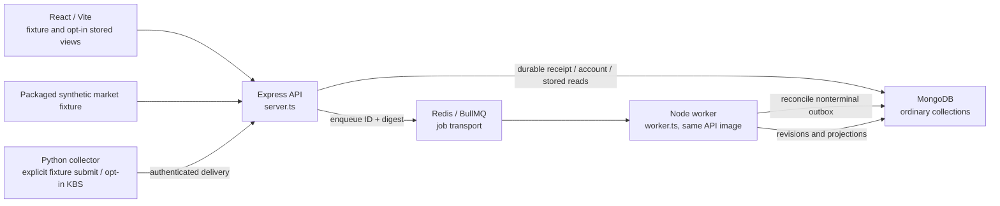
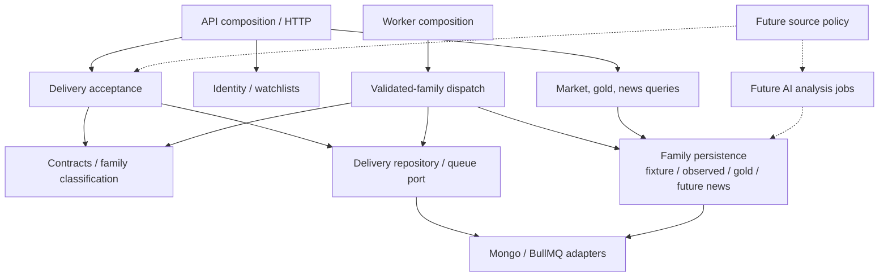
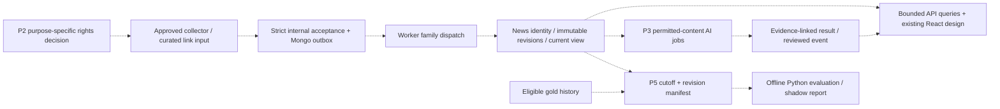

# System architecture — MarketPulse VN

**Decision date:** 18/10/2026 · **Scope:** A1 architecture decision, with A2 and A3 implementation evidence below.
**Merged baseline:** [PR #37](https://github.com/Son2110/Market-Pulse/pull/37),
`main` at `f51dbd3958dc0d4db6410d13c2a28085dcb02853` (A2 ingestion primitives).
[Application CI](https://github.com/Son2110/Market-Pulse/actions/runs/39106893071)
and [Documentation CI](https://github.com/Son2110/Market-Pulse/actions/runs/39106893021)
succeeded on that baseline (following [PR #36](https://github.com/Son2110/Market-Pulse/pull/36) at `a7206fee2fcfb317c2ee44c6342d3359510eea9e`). These runs do not validate the A3 working branch.

This decision follows the [original brief](../MarketPulse_VN_Project_Documentation.md),
[current PRD](PRD.md), [data contract](DATA_CONTRACT.md), [ingestion contract](INGESTION.md)
and [gold design](GOLD_DATA_DESIGN_P1.md). It separates working code from proposed
boundaries. A2 implements the shared JSON primitive extraction and A3 implements
validated-family classification and dispatch described below; source approval
and deployment remain separate decisions.

**Independent review · 18/10/2026:** GPT-6 Astra approved A1 with no findings
after comparing the document with server/health, ingestion, auth, gold storage,
Compose and CI code. The reviewer independently reran the documentation link
check (186 local targets), portal build (24 documents) and `git diff --check`;
all passed. This is documentation review evidence, not a new runtime test run.
A1 is now merged with successful remote CI as recorded above.

### A2 implementation evidence · 18/10/2026

The branch `feat/fr-18-ingestion-foundation-1` moved the existing `Json`,
`ContractError`, `canonicalJson`, `digest` and `strictJson` implementations verbatim
to [platform/contracts/json.ts](../apps/api/src/platform/contracts/json.ts), whose
only import is Node crypto. `ingestion-contract.ts` imports and re-exports those
same bindings for compatibility. Gold contracts/read validation/storage and
ingestion/observed consumers import primitives directly; family-specific
validation, decimal/time rules, storage, queue dispatch and identities stay in
their existing modules. This removes the gold contract's dependency on the
ingestion domain module without introducing a family framework or A3 dispatch.

Before extraction, the worker captured literal payload digests for fixture v1,
observed v2 and gold v1, plus a queue ID and representative persisted identities
for all three families. The existing ingestion test file now asserts those fixed
values, binding/`ContractError` identity, depth boundaries, null-prototype own
`__proto__` keys and existing native `SyntaxError` behavior for malformed strings.
The existing Python golden and live Python/Node JCS parity checks remain intact.
Local verification passed lint/typecheck, 186 Node unit tests, 41 real MongoDB/Redis
integration tests, API/web build, 44 Python contract tests, 29 collector tests,
both fixture validators, Compose configuration, four browser harness tests and
two desktop/mobile core-flow journeys, with no skipped tests. Documentation checks
passed for 188 local targets, the 24-document portal build and diff whitespace.
Test services use isolated loopback ports 27019/6381; existing stacks were not
changed and random test databases were cleaned. The original brief remains
unchanged (SHA-256 `21E98449A2A0BAA9B716F6720863A9902EBF605700D9B5229181C9121B2847F8`).
The full-suite results above are worker evidence. **Independent A2 review ·
18/10/2026:** GPT-6 Astra approved with no findings after inspecting all 13 changed
files, confirming newline-normalized implementation equality and no new dependency
cycles. The reviewer independently ran 13 focused tests, including the three new
tests; all passed. A2 is now merged via [PR #37](https://github.com/Son2110/Market-Pulse/pull/37)
with successful remote CI recorded above.

### A3 implementation evidence · 20/10/2026

The working branch `feat/fr-18-ingestion-foundation-2` introduces explicit internal
family classification and dispatch of validated legacy payloads without changing
accepted wire envelopes, RFC 8785 / SHA-256 digests, delivery IDs, deterministic
queue IDs (`jobId`) or BullMQ job names (`persist-fixture`, `persist-observed`,
`persist-gold`). `classifyPayload` in `ingestion-contract.ts` strictly validates
every payload through `validatePayload` first and returns a typed `ClassifiedPayload`
discriminated union (`fixture-market`, `observed-candle`, `synthetic-gold`); it never
infers family from `schemaVersion` alone and rejects injected `family` fields on
both the delivery envelope and inner payload.

`ingestion-store.ts` adds optional internal `family` metadata to `ingestion_deliveries`
(omitted from public/internal `receipt` responses), derives and verifies family,
provider, `schemaVersion`, dataset and digest on read via `classifyDelivery` so
legacy outbox rows without `family` remain supported without a database migration,
and dispatches persistence explicitly across `gold.persist`, `observed.persist`
and `persistFixture`. `ingestion-queue.ts` maps validated families to their existing
BullMQ job names via `queueJobName` and isolates corrupted or mismatched nonterminal
outbox rows during reconciliation by marking them terminal `failure` (`invalid_contract`)
so healthy deliveries continue. `ingestion-worker.ts` verifies `classifyDelivery` and
job-name compatibility before executing family persistence, treating contract or
job-name mismatches as permanent `invalid_contract` failures.

The earlier Gemini handoff reported 187 Node unit tests, 42 integration tests and
the supporting local checks; those are historical worker claims, separate from
the fresh verification below. Astra's initial review found that a new MongoDB
enum for optional `family` metadata prevented terminal failure updates to legacy
rows containing `family: "unknown"` or `family: null`, blocking reconciliation.
Sol reproduced MongoDB error 121 with a real-service regression, then removed
only that new enum restriction, retaining the pre-A3 strict core validator and
runtime `classifyDelivery` checks. Malformed metadata and raw payloads remain
available for diagnosis; no production validation bypass or data rewrite is used.
The regression places both malformed rows before a healthy delivery, verifies
terminal isolation and healthy completion, and confirms invalid core status
updates are still rejected. The existing all-family legacy and job-mismatch
regressions remain in place.

**Fresh Sol verification · 20/10/2026:** lint/typecheck, 187 Node unit tests,
43 real MongoDB/Redis integration tests, API/web build, 44 Python contract tests,
29 collector tests, both fixture validators, Compose configuration, four browser
harness tests and two desktop/mobile core-flow journeys passed with no skipped
tests. Isolated test services use loopback
ports 27019/6381 and remain available for independent review; test databases are
cleaned by the suites. The original brief remains unchanged (SHA-256
`21E98449A2A0BAA9B716F6720863A9902EBF605700D9B5229181C9121B2847F8`).
**Independent A3 review · 20/10/2026:** GPT-6 Astra approved the corrected
implementation with no remaining findings. The reviewer independently passed
two focused real MongoDB/Redis tests covering malformed-family isolation, strict
core validation, all three legacy families, pre-queued jobs and job-name mismatch,
plus `git diff --check`. The full-suite results above remain Sol worker evidence.
**Remote CI attempt · 20/10/2026:** [Application CI run 39395657217](https://github.com/Son2110/Market-Pulse/actions/runs/39395657217)
on `222daa9` failed during Compose startup, before application smoke/integration
checks: MongoDB reported fatal error 12257600, identifying a Linux kernel 6.19+
incompatibility. The application job is now pinned to `ubuntu-24.04` instead of
`ubuntu-latest` as a bounded runner compatibility change. MongoDB images and
required checks are unchanged; the retry and verification of this change remain
pending. This infrastructure failure does not provide remote acceptance of A3.

## Decision and constraints

Keep a **modular monolith**: one Node API/worker codebase, built from `apps/api`,
with separate HTTP API and BullMQ worker processes. Keep Python for bounded
provider collection and later offline forecast research. React calls the API;
it never calls Python, a data provider or an AI provider directly. MongoDB owns
durable delivery and domain records; Redis transports jobs. No market cache,
time-series projection, microservice split or general plugin framework is needed
for this foundation.

Modules will be extracted incrementally where a concrete task needs a boundary.
Keep existing route shapes, defaults, collection identities, hashes, decimal
precision, timestamp semantics, replay and E2E behavior. A1 creates no runtime
directory structure or new collection. The [roadmap](ROADMAP.md) sequences A2,
A3, P2.1 research and A4 before news ingestion or automated collection.

## Implemented baseline

| Area | Code and ownership today | Important limit |
|---|---|---|
| Composition | `apps/api/src/server.ts`, `health.ts`, `stores.ts`, `config.ts`; `worker.ts` composes the separate process | API startup and readiness require both MongoDB and Redis. Redis error/end after connection initiates API shutdown. |
| Accounts / watchlist | `auth.ts`, `watchlists.ts`; MongoDB `users`, `sessions`, `watchlists` | Auth rate limiting and KDF concurrency guards are in process, **not Redis-backed**. Sessions and ownership are Mongo-backed; this is the bounded local auth slice. |
| Fixture market reads | `fixture-market-data-provider.ts`, `stock-search.ts`, `daily-history.ts` | Search/history/default web views read the packaged fixture, not ingestion collections. |
| Ingestion contracts | `ingestion-contract.ts`, `gold-contract.ts`, `packages/schemas`; shared JSON primitives in `platform/contracts/json.ts`; validated-family classifier in `ingestion-contract.ts` on A3; Python validators and shared parity corpora | Strict fixture v1, observed candle v2 and synthetic gold v1 are different payload families; version alone cannot distinguish both v1 families, and wire discriminators are rejected. |
| Delivery lifecycle | `ingestion-api.ts`, `ingestion-store.ts`, `ingestion-queue.ts`, `ingestion-worker.ts` | Authenticated HTTP, Mongo outbox with derived legacy family support, bounded enqueue, reconciliation, attempts and receipt statuses already exist. |
| Family persistence | `IngestionStore` dispatches validated families to `ObservedStore`, `GoldStore` and `persistFixture` | Ordinary collections with unique identities; no MongoDB time-series collection or multi-document batch transaction. |
| Stored queries | `observed-history.ts`, collection-status contract, `gold-read.ts` and their services/contracts | Observed and gold flags default false. Gold P1.4 is API-only and synthetic-only. Reads do not repair projections, fetch providers or fall back to fixture. |
| Python / browser | `services/collector/collector`, `apps/web/src`, `tests/e2e` | Fixture validation/submission and bounded opt-in KBS collection exist. No automated gold/news collector, news/AI/forecast pipeline or gold UI exists. |

Compose runs MongoDB, Redis, API, worker and web; the collector is an explicit
profile command. API and worker use the same Dockerfile/build and separate entry
points; there is no implemented `apps/worker` service tree. Redis has AOF enabled
locally. This does not replace MongoDB as the ingestion authority or demonstrate
production durability, backup/restore or routing behavior.

### Existing data and completion semantics

1. The collector constructs the unchanged `{deliveryId, payloadDigest, payload}`
   envelope. The internal API authenticates, strictly parses/validates and verifies
   the RFC 8785 / SHA-256 payload digest before accepting it.
2. `ingestion_deliveries` stores the complete **normalized payload**, not provider
   wire bytes. An acknowledged Mongo insert with `w:1,j:true` precedes HTTP 202.
   Same delivery ID/digest returns its receipt; changed digest for that ID is 409.
   Mongo acceptance failure is 503. No successful acceptance response may precede
   durable Mongo acceptance.
3. Enqueue is bounded to 1.5 seconds. A failed/timed-out enqueue leaves the durable
   delivery for recovery. Jobs contain ID/digest; deterministic queue identity is
   secondary to Mongo receipt state. The worker scans up to 100 oldest nonterminal
   receipts at startup and every five seconds, within the existing three-attempt
   budget. Failure/exhaustion is terminal; recovery must not silently reset it.
4. The worker confirms family persistence before recording terminal `success`.
   HTTP 202 alone is not processing success; neither receipt success nor successful
   polling establishes source freshness, complete coverage or source rights.
   Document writes are atomic individually; partial rows can remain after failure.

| Family | Durable records | Ordering and replay to preserve |
|---|---|---|
| Synthetic market v1 | `canonical_assets`, `canonical_observations` | Immutable identity/content; exact replay is a no-op, conflicting content at the same identity fails without replacement. |
| Observed candle v2 | `observed_assets`, `observed_candle_revisions`, `observed_candles_latest` | Revision content is immutable; latest maximizes exact UTC microsecond collection time then digest. Original offset/string remains available; collection order does not prove market chronology. |
| Synthetic gold v1 | `gold_assets`, `gold_quote_revisions`, `gold_quote_snapshots`, `gold_quotes_latest` | Preserve complete first revision. Snapshot maximizes `(collectedOrder, contentDigest)`; asset latest maximizes `(sourceVerified, sourceOrder, collectedOrder, contentDigest)`. Reused A in A→B→A still advances/repairs both projections while retaining two revisions. |

Observed and gold store monetary values as canonical decimal strings; gold
timestamps preserve six UTC fractional digits, observed ordering preserves exact
UTC microseconds while retaining the original timestamp. Do not replace these
with floating-point money or millisecond-only `Date` ordering. Revision and
projection writes remain separate: history/latest can diverge until replay,
and stored reads can include rows from incomplete/failed deliveries. No read
claims an atomic batch, freshness or completeness from projection presence.

## Proposed module boundaries — not implemented directories

The following is a target dependency shape, not a mandatory folder migration.
`modules/<name>` under `apps/api/src` is an illustrative future location; use an
incremental extraction only when an approved task needs it. Existing files can
serve these boundaries until then. Do not relocate all files or add a generic
handler framework during A2/A3.

| Boundary | Owns | Allowed dependencies / exclusions |
|---|---|---|
| Composition (`server.ts`, `worker.ts`) | Config, concrete adapters, startup/shutdown, health wiring | Wires modules; domain code does not import entry points or start listeners. |
| Contract / family classification | Strict validation and a typed family result | Pure schema/identity/decimal/time primitives; no Express, queue, DB or provider calls. |
| Delivery lifecycle | Accept/idempotency/conflict, receipt state, attempts, reconciliation | Delivery repository and queue adapter ports; no news/gold economic rules. |
| Market / gold / future news domains | Family identity, revisions, ordering, projections and bounded query services | Contracts and own persistence adapters; no HTTP response objects or collector execution. Family rules stay explicit. |
| Identity / watchlists | Session authentication, account records and owner-scoped lists | Mongo repository and fixture query capability as today; no ingestion credentials or background AI dependency. |
| Source policy (future P2) | Purpose-specific rights decisions and provenance of evidence | Queried at collection/storage/redisplay/AI/training boundaries; cannot grant rights merely because a URL or feed is public. |
| AI analysis (future P3) | Bounded analysis jobs, evidence links, versions, budget, abstention | Approved content revisions and source policy; no direct market-price arithmetic or synchronous model call in public GET handlers. |
| Forecast research (future P5) | Offline dataset manifest, training/evaluation and go/no-go artifact | Approved snapshots/revisions and point-in-time evidence; no live DB writes or training inside HTTP requests. |

### Dependency and failure matrix

This table identifies the dependency a capability actually uses and the future
failure boundary to validate; it does not change today's all-dependency gate.

| Capability | Direct work dependencies | Current process constraint | Proposed A4 behavior / later gate |
|---|---|---|---|
| Fixture search/history | Initialized packaged fixture/catalog | API startup/readiness still requires Mongo + Redis | Keep initialized read capability available during Redis loss only after recovery and routing tests. |
| Account/session/watchlist | Mongo; initialized market provider for list presentation; in-process auth guards | Same API lifecycle | Fail affected writes/auth checks safely when Mongo is unavailable; Redis is not the auth limiter. |
| Stored observed/gold reads | Mongo, enabled flag and initialized API | Same API lifecycle; no queue call in the read service | Permit Mongo-backed reads during Redis degradation only after A4 proves behavior. |
| Internal delivery acceptance/poll | Mongo; configured secret and initialized delivery store; queue enqueue for new work | API Redis failure currently stops the process | Preserve durable accept-before-202 and deferred enqueue/reconciliation. Mongo unavailable must not acknowledge acceptance. |
| Worker persistence/recovery | Mongo + Redis/BullMQ, initialized stores, running worker, recent reconciliation | Worker already has separate readiness | Pause/fail safely during dependency loss; prove recovery, bounded retry and no identity/order regressions before automation. |
| Future collection / AI / forecasts | Approved source access, network/model budget or eligible dataset as appropriate | Not implemented | Isolate failures from public read handlers; each task supplies its own evidence and gate. |

`GET /health/live` currently reports process/HTTP liveness without probing stores.
`GET /health/ready` currently probes Mongo and Redis plus application initialization;
the worker has its own loopback readiness listener on port 3002. Keep full readiness
as **all enabled required dependencies and initialization**, distinct from liveness.
A4 will define capability-specific readiness for reads, ingestion and worker work,
with sanitized dependency status and tests for startup, loss and restoration.
It must also change the current Redis shutdown/reconnect behavior if degraded
reads are to survive. Do not merely remove a readiness check.

Compose currently uses full API readiness; a deployment/load balancer using that
same probe may remove the entire instance during Redis loss. Capability readiness
does not by itself make degraded reads reachable. Validate deployment routing or
a separate read-serving arrangement before claiming external availability. No
production load-balancer behavior has been demonstrated by A1.

## Future source, news, AI and forecast flow

Dashed edges are proposed. P2.1 will define a small source-rights registry design,
not a generic permissions platform or implemented collection. Record access,
storage, public redisplay, AI input and model training **separately**, with source,
scope, evidence/date, limits, expiry/recheck and decision owner. `unknown` stays
closed for that purpose; permission for metadata is not permission for full text,
AI or training. Resolve retention/deletion obligations per right and data class
before collecting; today's absence of TTL on synthetic raw/revisions is not a
promise to keep licensed content or full text forever. Retain audit identifiers
or evidence only within the applicable permission. Source-specific gates can
remain stricter; the gold live-source gate remains closed.

P2 news will separate canonical article identity from content revisions and
collection times; canonical URL/publisher, published/updated/collected timestamps,
language and provenance remain explicit. P2.1 must settle permitted fields and
dedup/revision policy before P2.2 ingestion; no full-text fetch is implied by RSS.
P2.3 adds bounded query/UI states using the existing app design. Cross-family
delivery lifecycle may be reused, but economic/article identity rules stay local.

P3 runs permitted-content AI work asynchronously with model/prompt/input-revision
versions, citations, budget, timeout and deterministic fallback to source links.
Treat source text as untrusted data. Prices/spreads/returns come from code; facts,
computed measurements and interpretation remain distinguishable. Proposed events
need human review; unsupported claims abstain. The PRD held-out evaluation gate
must pass before exposing the corresponding analysis. No LLM price oracle or
investment recommendation is authorized.

P5 is offline research first. Its dataset manifest must freeze source rights,
series/target/horizon/threshold, timezone and cutoff, extraction/version, exact
input revision/delivery identities and hashes, availability times and split dates.
Select only data known by each cutoff, including news publication/collection,
gold corrections and macro vintages; a later winning revision cannot silently
rewrite an earlier training example. Keep immutable eligible dataset artifacts
under a rights-aware retention policy. Baseline, walk-forward, untouched holdout,
calibration and matured-target shadow results produce a versioned go/no-go report.
Do not add online model serving or forecast storage in A1–A4; only a future gated
task may publish a validated report/probability artifact to the app.

## Compatibility, rollout and rollback

| Serial task | Bounded change | Acceptance and rollback boundary |
|---|---|---|
| A1 · architecture decision | Documentation and portal navigation | Local link/build checks passed; independent GPT-6 Astra review approved with no findings. Merged baseline CI passed as linked above. No runtime behavior changed. |
| A2 · ingestion primitives | Shared JSON primitives extracted; domain rules remain local | Existing Node/Python parity, identities/hashes, decimals/microseconds and ingestion tests remain authoritative; local checks, independent GPT-6 Astra review and merged baseline CI passed as recorded above. Revert extraction if parity changes; no bulk migration. |
| A3 · family dispatch | Explicit internal classification/dispatch of **validated legacy payloads** on the working branch | Preserves all three existing envelopes, digests, delivery IDs, queue IDs and BullMQ job names; tests verify replay/recovery, legacy nonterminal outbox rows without `family`, and invalid-contract isolation. Local checks passed and independent GPT-6 Astra review approved on 20/10/2026 as recorded above; remote CI pending. Revert code without data rewrite. |
| P2.1 · source research | Decide allowed news fields, purpose-specific rights and retention | Research only; no new collector or automatic jobs. |
| A4 · dependency health/recovery | Change Redis lifecycle, capability readiness and recovery deliberately | Required before P2.2 or any automated collector; verify dependency loss/restoration, outbox, retries and read/routing claims. Roll back to prior API/worker pair if regression. |

The classifier inspects a payload only after its existing strict validation,
yielding an internal family (`fixture-market`, `observed-candle` or
`synthetic-gold`). It is not a new wire discriminator. Do not infer family from
`schemaVersion` alone, change accepted JSON to inject a field, or alter the bytes
that participate in any digest/identity. Derive classification for legacy outbox
rows on read; optional internal `family` metadata is additive and its absence is
tolerated. No bulk database migration is required for A2/A3.

Keep queue payload/name/job identities compatible with jobs already waiting or
retrying. Keep projection ownership and per-document ordering unchanged across
API/worker versions. Release/revert a compatible API/worker pair; validate a new
family before allowing it to submit work an older worker cannot understand.
Never clear receipts, revisions or queues as a routine rollback. A future storage
change needs its own compatibility and recovery plan, with backup/restore evidence.

Run applicable existing checks for each runtime task: Node lint/typecheck/unit,
real MongoDB/Redis integration, Python contracts/collector checks, fixture
validators, build/Compose smoke and committed Playwright core journeys as required
by Application CI. Do not invent a runtime acceptance result for this docs task.

## ADR-001 — why this foundation

**Accepted decision, 18/10/2026:** incremental modular monolith, two Node process
roles and specialist Python commands/offline research. A single developer and
serial workflow benefit from one contract and deployment lineage; existing
outbox and family stores already provide the key ingestion seam. Separate worker
execution keeps background work out of request handling without requiring network
contracts between every domain.

**Tradeoffs:** shared release/DB still couples domains; API startup currently
over-couples read availability to Redis; classification and persistence branches
can grow. Explicit module ownership, A2/A3 extraction and A4 failure tests address
those concrete problems. In-process auth limits also do not provide a global
limit across future API replicas; scaling requires a separate reviewed decision.

**Alternatives deferred:** microservices add deployment, distributed tracing and
contract overhead before independent scaling/ownership evidence; a generic
ingestion framework hides family-specific revision rules; a mass folder move adds
review/rollback risk without capability; a new time-series projection/cache needs
measured query demand plus rebuild/invalidation evidence. Revisit these decisions
when measured workload, operational ownership or isolation requirements justify
them, rather than treating the original conceptual diagram as implemented code.

**Open decisions:** source rights/retention in P2.1 and the gold gate, concrete A4
readiness/routing contract, news identity/revision semantics, AI provider/budget,
forecast-eligible history and production backup/network/cost. None is silently
resolved by this architecture document.
